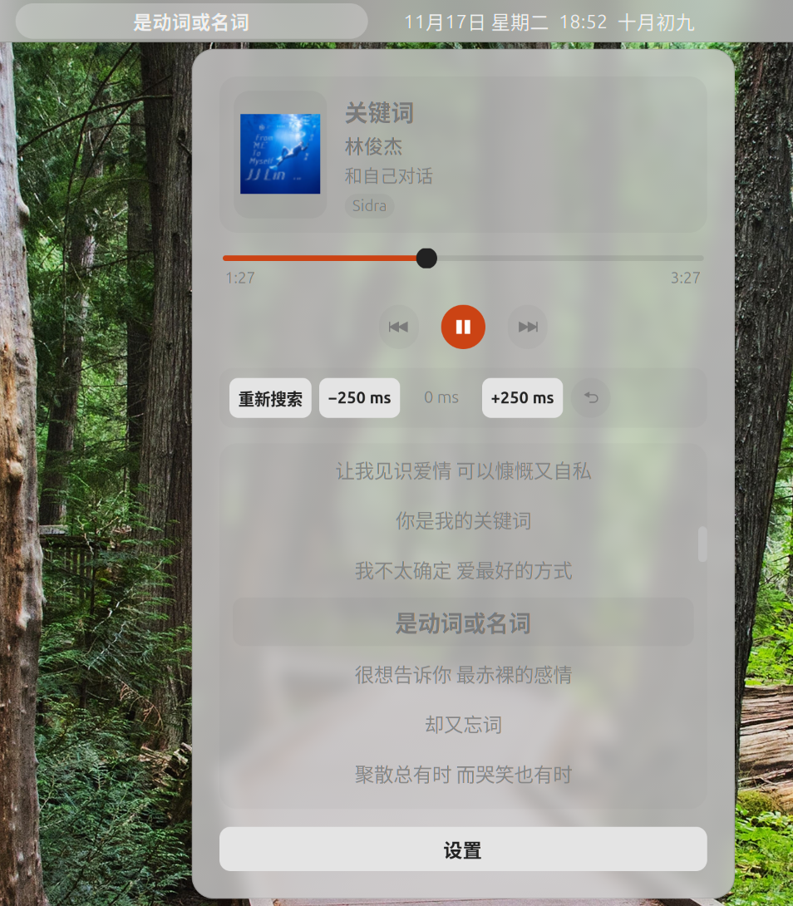
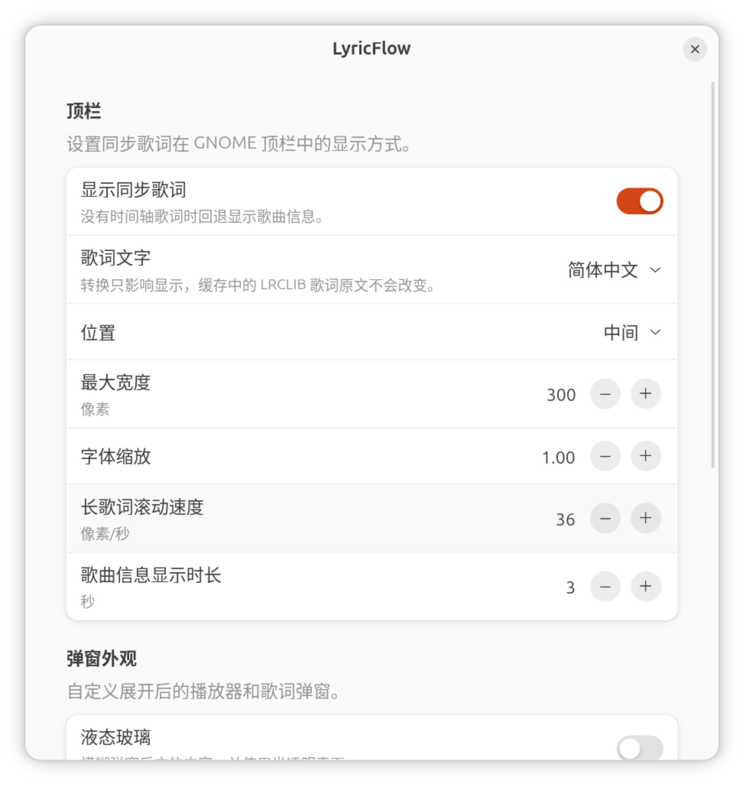

# LyricFlow

LyricFlow 是一个面向 **GNOME Shell 50** 的顶栏同步歌词扩展。在支持 MPRIS 的播放器中播放音乐后，顶栏会显示歌曲信息与当前歌词；点击顶栏即可展开封面、播放控制、进度条和完整歌词。

扩展直接通过会话 D-Bus 与播放器通信，不需要单独启动后台服务。歌词优先从 LRCLIB 获取，并在需要时查询网易云音乐；已有歌词缓存可以先展示，再在后台刷新。


- [功能与兼容范围](#功能与兼容范围)
- [安装](#安装)
- [首次使用与设置](#首次使用与设置)
- [更新与卸载](#更新与卸载)
- [工作原理](#工作原理)
- [隐私与本地数据](#隐私与本地数据)
- [常见问题](#常见问题)
- [开发与测试](#开发与测试)
- [English](#english)
- [许可证与项目说明](#许可证与项目说明)

## 功能与兼容范围

- **顶栏歌词**：切歌后先显示歌曲信息，再按播放位置切换同步歌词；长文本支持横向滚动。暂停时播放位置停止推进，没有可识别的歌曲时自动隐藏。
- **播放器弹窗**：显示播放器名称、歌曲、歌手、专辑、封面、播放进度与完整歌词，支持上一首、播放／暂停和下一首。
- **歌词交互**：拖动进度条调整播放位置，点击同步歌词跳转到对应时间；操作是否可用取决于播放器提供的控制能力。
- **匹配与校时**：可以重新搜索并选择歌词候选，按 250 毫秒调整全局偏移，最大范围为 ±10 秒。
- **文本与外观**：默认离线转换为简体中文，也可选择标准繁体或保留原文；支持顶栏位置、宽度、字号、滚动速度，以及可选的弹窗模糊与半透明效果。
- **缓存与网络回退**：过期文本先展示，再后台查询；请求失败时尽量保留已有歌词，手动搜索失败不会清空当前歌词。

当前兼容声明为 GNOME Shell 50，测试环境为 **Ubuntu 26.04／GNOME Shell 50.1**。其他 GNOME 主版本及其他桌面环境不在当前兼容范围内。

播放器需要通过 **MPRIS 2.2** 提供歌曲标题、播放状态等元数据。Spotify、Rhythmbox 等提供 MPRIS 接口的播放器可作为接入对象，但并非每个播放器版本、安装方式和控制功能都已逐一验证。浏览器是否可用还取决于浏览器、网页和媒体会话是否实际暴露 MPRIS 信息；仅在网页中播放声音并不一定会被识别。

## 安装

请在已登录 GNOME 图形会话的普通用户终端中操作。安装到用户目录不需要 `sudo`；下方只有系统依赖安装使用管理员权限。

### 方式一：从源码构建并安装

#### 1. 检查桌面环境

```bash
gnome-shell --version
printf '%s\n' "$XDG_SESSION_TYPE"
```

确认 GNOME Shell 主版本为 50。Wayland 图形会话可按下述步骤安装；安装完成后通过注销、重新登录加载扩展。

#### 2. 安装依赖

在 Ubuntu 26.04 上准备构建与测试工具：

```bash
sudo apt update
sudo apt install git make zip gettext libglib2.0-bin nodejs npm \
  gjs dbus-daemon gir1.2-soup-3.0 gir1.2-gtk-4.0 gir1.2-adw-1
```

依赖的用途如下：

| 类型 | 组件 | 用途 |
| --- | --- | --- |
| 桌面运行环境 | GNOME Shell 50、GJS | 加载扩展；`gnome-extensions` 命令由 GNOME Shell 提供 |
| 歌词请求与设置页 | Soup 3、GTK 4、libadwaita 的 GI 类型信息 | 发起 HTTP 请求、显示原生设置窗口 |
| 源码构建 | Git、Node.js、npm、Make | 获取源码、安装锁定依赖、编译 TypeScript |
| 资源与打包 | `glib-compile-schemas`、`msgfmt`、`zip` | 编译设置 schema、翻译文件并生成 ZIP |
| 集成测试 | `gjs`、`dbus-run-session` | 在独立 D-Bus 会话中执行运行时测试 |

检查 Node.js 和 npm：

```bash
node --version
npm --version
```

项目已在 **Node.js 26.13.1、npm 11.20.0、GJS 1.88.0** 下验证。这是已测试的工具组合，不代表已验证所有较低版本；若使用其他版本，应以构建和测试结果为准。安装系统包后请以实际输出确认版本。

#### 3. 获取源码并构建

```bash
git clone https://github.com/keen-leen/lyricflow.git
cd lyricflow
npm ci
make pack
```

`npm ci` 根据仓库中的 `package-lock.json` 安装依赖。`make pack` 会依次完成源码与资源构建、单元及集成测试，再生成：

```text
lyricflow@keen.local.zip
```

构建产物位于 `dist/`，测试编译产物位于 `.test-dist/`。集成测试需要能够创建本地 D-Bus 和 HTTP socket，因此应在正常本地环境中执行。

#### 4. 安装 ZIP

在项目目录执行：

```bash
gnome-extensions install --force ./lyricflow@keen.local.zip
```

默认安装位置是：

```text
~/.local/share/gnome-shell/extensions/lyricflow@keen.local/
```

如果设置了 `XDG_DATA_HOME`，则位于该目录下的 `gnome-shell/extensions/lyricflow@keen.local/`。

#### 5. 注销、重新登录并启用

保存正在进行的工作，通过桌面会话菜单注销后重新登录，再执行：

```bash
gnome-extensions enable lyricflow@keen.local
gnome-extensions info lyricflow@keen.local
```

随后打开一个支持 MPRIS 的播放器并播放歌曲。顶栏默认位于中央；没有播放器或有效歌曲标题时，LyricFlow 会隐藏，因此启用后不一定立即看到歌词区域。

### 方式二：安装已有 ZIP

如果你已取得构建好的 `lyricflow@keen.local.zip`，不需要安装 Node.js、npm 或克隆源码。仍需满足前面的 GNOME 运行环境与 GI 组件要求。

在 ZIP 所在目录执行：

```bash
gnome-extensions install --force ./lyricflow@keen.local.zip
```

注销并重新登录，然后执行：

```bash
gnome-extensions enable lyricflow@keen.local
gnome-extensions info lyricflow@keen.local
```

本说明不假设仓库已提供预编译 Release；源码构建是获取安装包的完整路径。

## 首次使用与设置

### 播放与歌词操作

1. 启动支持 MPRIS 的播放器，选择一首带有标题和歌手信息的歌曲。
2. 切歌后，顶栏默认先显示 **3 秒歌曲信息**。缓存读取或网络查询完成后，有同步歌词时按播放位置切换；没有同步歌词时顶栏显示歌曲信息。
3. 点击顶栏展开播放器弹窗。纯文本歌词可以在弹窗阅读，但不能按时间定位或点击跳转。
4. 若匹配不准确，点击“重新搜索”，从返回的候选中选择合适版本。搜索期间保留已有歌词，失败时给出提示；有候选时弹窗改为候选列表。
5. 若歌词整体提前或落后，使用弹窗的 `−250 ms`、`+250 ms` 和重置按钮调整。

**正偏移会提前显示歌词，负偏移会延后显示歌词。** 例如歌词比音乐晚出现，可增加正偏移。偏移是全局设置，会影响其他歌曲，不是单首歌曲的独立校准。

播放控制按钮和进度拖动会根据播放器能力启用或禁用。点击同步歌词时，如果播放器允许跳转和播放，扩展会跳转到扣除偏移后的播放位置，并在需要时请求继续播放。



### 打开设置

在弹窗中点击“设置”，或运行：

```bash
gnome-extensions prefs lyricflow@keen.local
```

| 设置项 | 默认值 | 可选值或范围 |
| --- | --- | --- |
| 顶栏同步歌词 | 开启 | 开启／关闭；关闭后顶栏显示歌曲信息 |
| 歌词文字 | 简体中文 | 简体中文／标准繁体／保留原文 |
| 顶栏位置 | 中央 | 左侧／中央／右侧 |
| 最大宽度 | 360 像素 | 160～720 像素 |
| 字体缩放 | 1.0 | 0.7～1.8 |
| 长文本滚动速度 | 36 像素／秒 | 12～120 像素／秒 |
| 切歌信息显示时间 | 3 秒 | 1～10 秒 |
| 全局歌词偏移 | 0 毫秒 | −10,000～+10,000 毫秒；界面步长 250 毫秒 |
| 液态玻璃外观 | 关闭 | 开启后使用弹窗背景模糊与半透明表面 |
| 玻璃强度 | 标准 | 轻度／标准／强烈；开启玻璃外观后可调 |

简繁转换只作用于展示文字，不改写缓存中的原始歌词。模糊效果的实际外观受主题和图形环境影响；模糊不可用时会尝试使用半透明样式。



## 更新与卸载

### 更新已有安装

在源码目录中更新代码后，重新安装依赖并打包：

```bash
git pull
npm ci
make pack
gnome-extensions disable lyricflow@keen.local
gnome-extensions install --force ./lyricflow@keen.local.zip
```

注销并重新登录，再启用：

```bash
gnome-extensions enable lyricflow@keen.local
```

替换 ZIP 后，已运行的 Shell 可能仍持有旧 JavaScript 模块。仅禁用、重新启用不能作为可靠的代码重载方式；更新后仍按上面的注销流程加载。

### 临时禁用与卸载

临时禁用：

```bash
gnome-extensions disable lyricflow@keen.local
```

卸载扩展：

```bash
gnome-extensions disable lyricflow@keen.local
gnome-extensions uninstall lyricflow@keen.local
```

这些命令不主动清理项目源码或歌词缓存。本说明也不默认重置个人设置。

### 清理构建产物或歌词缓存

在源码目录执行以下命令，只清理本项目的构建产物、测试编译产物和安装 ZIP，不卸载已安装扩展，也不删除歌词缓存：

```bash
make clean
```

如果需要重新查询所有歌词，可先禁用扩展，再**单独**清理歌词缓存：

```bash
gnome-extensions disable lyricflow@keen.local
rm -rf -- "${XDG_CACHE_HOME:-$HOME/.cache}/lyricflow/lyrics"
gnome-extensions enable lyricflow@keen.local
```

这会删除已缓存歌词及手动选择的匹配结果；下次播放需要重新查询。日常重启、构建和更新不会自动清空缓存。缓存不提供历史格式兼容或迁移，开发中修改格式时直接清理重建。

## 工作原理

### 播放器发现与时间同步

LyricFlow 异步监听会话 D-Bus 上的 MPRIS 播放器，读取歌曲元数据、播放状态和控制能力。多个播放器同时存在时，优先选择正在播放的播放器；状态相同时倾向最近活动的播放器。没有有效歌曲标题的播放器不占用顶栏。

播放器给出播放位置后，扩展结合单调时钟和播放速率估计当前位置；收到切歌、跳转或状态变化时重新同步。同步歌词根据 LRC 时间戳定位当前行，并叠加全局偏移。切歌和切换播放器会取消旧查询，迟到的结果不会覆盖当前歌曲。

### 歌词查询与回退

```text
发现当前歌曲
    ↓
异步读取本地缓存
    ├─ 新鲜缓存：直接使用
    └─ 无缓存／已过期：先展示已有文本，再查询 LRCLIB
                               ├─ 合格同步歌词：结束自动查询
                               └─ 2 秒仍未取得同步歌词：启动网易备用查询
                                  （主源提前结束且无同步歌词时立即启动）
```

LRCLIB 会依次尝试精确查询、按歌曲和歌手搜索，以及清理部分展示性后缀后的宽泛搜索。候选结合标题、歌手、专辑和时长进行筛选，同步歌词优先。

自动查询拿到合格同步歌词后会取消其余请求；手动搜索则尽量汇总两源候选。网络阶段共用 **15 秒预算**，重试也包含在内。超时已有文本或候选时尽量保留；没有可用结果时显示失败。纯音乐需要两源共同确认，部分失败或超时不会缓存为“确认没有歌词”。

### 缓存与刷新

| 缓存内容 | 新鲜期 | 过期后的处理 |
| --- | --- | --- |
| 同步歌词 | 30 天 | 先展示已有歌词，再后台刷新 |
| 纯文本歌词 | 24 小时 | 先展示，再尝试获取更合适或同步的歌词 |
| 确认未找到／纯音乐 | 24 小时 | 下次播放重新查询 |

歌曲缓存身份保留版本信息，并使用标题、歌手、专辑和毫秒精度时长区分曲目，文件名使用 SHA-256。它与搜索时的宽松匹配规则分开处理，减少现场版、重制版等版本误用同一份缓存的情况；这不代表所有网络候选都能保证匹配准确。

缓存采用异步读写和原子替换，读取时检查数据结构、歌曲身份和文件大小。单文件最多 1 MiB；首次成功写入后进行清理，此后最多每小时一次，按 1,000 个文件、32 MiB 的目标淘汰过期未命中和较旧条目。容量允许时保留过期文本供离线使用，因此这两个容量目标不是每次写入后的硬上限。

无播放器或暂停时停止周期性的播放刷新，切歌信息展示期限仍由一次性计时器处理。播放且弹窗关闭时按下一条歌词的时间调度；弹窗打开时进度保持 100 毫秒刷新。这里不意味着所有动画都随暂停冻结。

## 隐私与本地数据

查询歌词会向 [LRCLIB](https://lrclib.net) 发送歌曲标题、歌手、可用的专辑和时长等元数据。触发备用查询或手动候选搜索时，还可能向 [网易云音乐](https://music.163.com) 发送用于搜索的歌曲元数据，并请求候选歌曲 ID 对应的歌词。

扩展不发送账号、Cookie、播放历史列表或歌词正文；歌词服务仍会收到本次请求的歌曲信息。中文文字转换在本地完成。

歌词缓存位于：

```text
$XDG_CACHE_HOME/lyricflow/lyrics/
```

未设置 `XDG_CACHE_HOME` 时使用 `~/.cache/lyricflow/lyrics/`。显示与偏移设置由 GSettings 保存，路径为 `/org/gnome/shell/extensions/lyricflow/`；缓存与设置是两类独立数据。

## 常见问题

### 已启用，但顶栏没有显示

先确认播放器正在播放歌曲，且能提供有效歌曲标题；没有可识别歌曲时扩展会隐藏。默认位置在顶栏中央，也可通过设置窗口检查位置与宽度。

检查当前会话有没有 MPRIS 播放器名称：

```bash
gdbus call --session \
  --dest org.freedesktop.DBus \
  --object-path /org/freedesktop/DBus \
  --method org.freedesktop.DBus.ListNames
```

输出中应能看到形如 `org.mpris.MediaPlayer2.…` 的名称。没有此类名称时，扩展无法发现播放器；有名称但没有歌曲标题时，也可能暂不显示。浏览器中的不同网页可能表现不同。

### 提示找不到扩展，或安装后无法启用

确认 UUID 使用 `lyricflow@keen.local`，安装命令没有以 root 身份执行，并且安装后已经注销、重新登录。然后查看：

```bash
gnome-shell --version
gnome-extensions list
gnome-extensions info lyricflow@keen.local
```

Shell 主版本不是 50 时不在当前兼容声明内。不要通过修改版本声明来替代兼容性验证。

### 没有歌词、只有纯文本，或匹配到了错误版本

歌词来源未必收录该歌曲或对应版本。检查播放器给出的标题和歌手是否准确，再使用“重新搜索”选择候选。网络超时或服务暂时不可用时，可稍后重试；已有文本缓存会尽量保留。

纯文本歌词没有时间戳，只能在弹窗阅读，顶栏会回到歌曲信息。整体时间偏差可调整偏移；如果不同段落的偏差不同，通常需要更合适的歌词版本，单一全局偏移无法修正。

### 无法拖动进度，或点击歌词不能跳转

检查歌词是否带同步时间戳，以及播放器是否允许控制和跳转。部分网页、直播或播放器没有实现相应 MPRIS 能力，此时相关操作会不可用。

### 更新后仍然表现为旧代码

确认安装的是最新构建的 ZIP，并注销、重新登录。`make build` 只生成源码构建产物，不会更新桌面中已安装的扩展；`make pack` 也只生成安装包。

### 构建或测试失败

`npm ci` 需要能访问依赖来源，并要求锁文件与依赖声明一致。`make pack` 还会运行需要本地 socket 的集成测试；如果在受限容器或沙箱中遇到 D-Bus 绑定被拒绝，应在允许创建这些 socket 的环境中运行。

若缺少命令，回到安装依赖步骤检查 `glib-compile-schemas`、`msgfmt`、`gjs` 和 `dbus-run-session`，并查看构建输出中最先出现的错误。

### 查看运行日志

在终端运行：

```bash
journalctl -f -o cat /usr/bin/gnome-shell
```

重现问题后查看带有 `LyricFlow` 的消息。反馈问题时可附上 GNOME 版本、播放器名称、复现步骤和相关日志。

## 开发与测试

所有命令在源码根目录执行：

| 命令 | 作用 |
| --- | --- |
| `make check` | TypeScript 类型检查，不生成编译输出 |
| `make build` | 编译源码、schema、翻译并复制运行资源到 `dist/` |
| `make test` | 运行单元测试和隔离运行时集成测试 |
| `make pack` | 构建、测试并生成安装 ZIP |
| `make shell-test` | 先打包，再在临时环境安装扩展并运行无窗口 Shell 回归 |
| `make install` | 构建、测试、打包并安装；仍需按安装章节重新登录加载 |
| `make clean` | 清理构建产物、测试编译产物和安装包 |

`make test` 对应 `npm test`，测试编译到 `.test-dist/`，不依赖现有 `dist/`。运行时测试使用临时缓存目录、独立 D-Bus 会话和本地 HTTP 服务，覆盖缓存、请求调度与播放器生命周期。

`make shell-test` 需要 GNOME Shell 50 提供的 `gnome-shell-test-tool` 及可运行的无窗口图形环境，覆盖切歌保护、进度更新、歌词点击与滚动定位。

仓库还提供不播放声音的模拟 MPRIS 播放器，可在开发测试会话中运行：

```bash
gjs -m tests/integration/mock-player.js
```

它用于验证发现和控制路径，不代表公网歌词服务一定会返回结果。建议在单独的测试会话中使用，避免影响日常播放器选择。

源码按职责分布在 `src/player/`（播放器）、`src/lyrics/`（查询与歌词处理）、`src/cache/`（缓存）、`src/ui/`（界面），由 `src/extension.ts` 组织生命周期；`src/prefs.ts` 提供设置窗口。

性能脚本位于 `tests/integration/shell-benchmark.js`。具体夹具、原始数据、测量限制和复现步骤见 [缓存、请求与 UI 测量报告](measurements/README.md)。这些是受控实验结果，不作为所有播放器、网络和桌面环境的速度保证。

## English

LyricFlow is a GNOME Shell 50 extension for synchronized lyrics in the top bar. Its popup includes artwork, playback controls, a seekable progress bar and full lyrics. Players must expose song metadata through MPRIS.

Build with `npm ci` and `make pack`, install `lyricflow@keen.local.zip` using `gnome-extensions install --force`, then log out and back in before enabling `lyricflow@keen.local`. Ubuntu 26.04 / GNOME Shell 50.1 is the tested desktop environment.

Lyrics are fetched from LRCLIB with a delayed NetEase fallback. Cached text is shown before background refresh; network queries share a 15-second budget. Chinese script conversion runs locally. The installed extension requires no separate background service or Node.js runtime.

## 许可证与项目说明

项目采用 **GPL-3.0-or-later**，见 [LICENSE](LICENSE)。打包使用的 `opencc-js` 1.4.2 及词典包含 MIT 与 Apache-2.0 许可内容，对应许可证和第三方声明随扩展 ZIP 一并提供。

本项目为 AI 辅助开发的个人项目。沿用当前维护约定：在理解代码并具备维护能力之前，请勿将其上传到 extensions.gnome.org。
